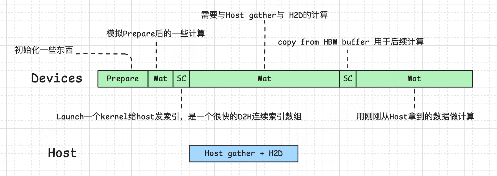

<!-- SPDX-License-Identifier: Apache-2.0 -->
<!-- SPDX-FileCopyrightText: Copyright contributors to the vLLM project -->

# TPU 上 Engram Host 取数方案对比

Engram 的嵌入表放在 CPU 内存里，模型每步要从里面取一部分行送到 TPU。
本文比较三种取数做法：Host 线程轮询、XLA Host 调用（FFI）、TPU 直接 DMA。

## 1 测试方法

测试按 Engram 的实际规模建模，每个 rank 每步做一次查表：

- CPU 内存里一张 4800 万行的表，每行 256 B，约 12.3 GB。
- 每步随机取 6912 行，共 1.69 MiB，行号每步都变。

每步是一张计算图：

```text
准备 -> 前段计算 -> 发出取数请求 -> 中段计算 -> 等数据 -> 后段计算（用这些行）
```



图以方案一为例。Mat 是矩阵乘，SC 是 SparseCore 上的 kernel。
第一个 SC 把行号发给 Host，Host 取行并传到 HBM 的同时，TPU 在做中段计算。

- **中段计算**代表"发出请求之后、用到数据之前"的那段模型计算。它和取的行无关，可以用来盖住取数的时间。
  它由若干个 2048×2048 bf16 矩阵乘组成，每个约 20 µs，改变矩阵乘的个数就能改变这段时间的长短。
- **纯计算基线**：同样的图，但不取数。
- **指标**：每步 TPU 上的耗时比纯计算基线多多少。多出的部分就是取数的真实代价。
- **正确性**：每步把取回的行逐字节和 CPU 上的期望值比对。

## 2 Engram 查表的过程

Engram 是一张很大的嵌入表。它放在 CPU 内存里，不占 TPU 的 HBM。每步的过程：

1. **TPU**：根据输入 token 算哈希，得到要查的行号。
2. **Host**：按行号从大表里取出这些行。
3. **传输**：把这些行搬到 HBM。
4. **TPU**：在某一层用这些行参与计算。DeepSeek V4.1 里是第 1 层和第 14 层。

| | 做什么 |
| --- | --- |
| Host | 存表；按行号取行 |
| TPU | 算行号、发请求、等数据到位、使用数据 |

关键在于：行号要等 token 出来才知道，而数据必须在用到它的那一层之前到位。
中间那几层的计算就是能用来盖住取数的时间。
真实模型里，行按 rank 分片存放，取回后还要在 rank 之间交换；本测试只建模每个 rank 自己的那一份。

## 3 三种方案

下文中 SparseCore 和 TensorCore 是 TPU 上的两类计算单元。
pinned 内存是锁页的 Host 内存，TPU 可以直接用 DMA 读写它。

| 方案 | Host 做什么 | TPU 做什么 |
| --- | --- | --- |
| 一：Host 线程轮询 | 常驻 C++ 线程：等请求、取行、写进 HBM、写完成标记 | 写请求；检查完成标记；复制一份结果 |
| 二：XLA Host 调用 | XLA 在 Host 上调用 C++ 取行函数 | 写请求；等 Host 函数完成；DMA 到 HBM |
| 三：TPU 直接 DMA | 不参与，只提供一张 pinned 表 | 逐行把所在的 4 KiB 页 DMA 到 HBM，再取出这一行 |

### 方案一：Host 线程轮询

1. TPU 的 SparseCore 把行号写到 pinned 内存，再写一个序号，表示"请求已发出"。
2. Host 上的常驻 C++ 线程看到新序号，从表里取出这些行，用 PJRT 的底层拷贝接口直接写进一块事先保留的 HBM buffer，
   完成后写回序号，表示"数据已到"。
3. TPU 算完中段计算后，由 SparseCore 读这个序号，对上了就由 TensorCore 把 HBM buffer 复制一份新的，交给后段计算使用。

最后要复制一份，是因为编译器不知道这块 HBM 被 Host 改写过，可能在写完之前就复制它，实测会读到旧数据。

### 方案二：XLA Host 调用（FFI）

1. TPU 把行号写到 pinned 内存。
2. 图里有一个放在 Host 上执行的算子（JAX 的 `compute_on("device_host")` 加 `ffi_call`）。
   XLA 执行到这里时，在 Host 上调用 C++ 取行函数，结果写进 pinned 内存。
   这个调用是异步的，Host 取行的同时 TPU 照常算中段计算。
3. 取行完成后，TPU 发一次 DMA，把结果搬到 HBM。

不需要常驻线程，也不需要轮询，等待由 XLA 自己处理。

### 方案三：TPU 直接 DMA

1. 表事先复制一份到 pinned 内存。
2. TPU 的 SparseCore 为每一行发一个 DMA，把该行所在的 4 KiB 页搬到 HBM。
3. 全部 DMA 完成后，在 TPU 上从每页里取出需要的那一行。

完全不需要 Host CPU 参与。

## 4 结果

**正确性**：三种方案各测了 384 次（48 步 × 8 个 rank），取回的行全部正确。

**每步 TPU 耗时**（µs，括号里是比纯计算基线多出的部分）：

| 中段计算长度 | 纯计算 | 方案一 | 方案二 | 方案三 |
| --- | ---: | ---: | ---: | ---: |
| 约 0.7 ms | 890 | 975 (+86) | 987 (+97) | 1935 (+1045) |
| 约 1.4 ms | 1570 | 1720 (+150) | 1642 (+72) | 2617 (+1047) |
| 约 2.8 ms | 2930 | 3211 (+280) | 3011 (+80) | 3944 (+1014) |

**能否盖住取数时间**：

| 方案 | 中段计算至少要多长才能完全盖住 | 盖住后还剩什么 |
| --- | --- | --- |
| 一 | 约 0.6 ms | 取数机制本身约 10–20 µs；其余来自矩阵乘变慢（见第 5 节） |
| 二 | 约 0.4 ms | 约 50 µs 的 Host 到 HBM 传输没盖住 |
| 三 | 盖不住 | 约 0.9 ms 的 DMA |

**完整模型**（DeepSeek V4.1 Decode 每步中位数，以前的实验）：

| 对比 | 结果 |
| --- | --- |
| 方案三与方案一（相同输入） | 方案三 45.118 ms，方案一 43.303 ms |
| 方案二与方案一（同一模型版本，编译和内存分配器设置相同） | 方案二 42.838 ms，方案一 42.486 ms |

完整模型里方案一最快。但两组对比的表布局等配置也有差别，只能看大致趋势。

## 5 各方案的问题

### 方案一：Host 线程轮询

- **矩阵乘变慢**：测试里方案一的图中每个矩阵乘是 20.0 µs，纯计算是 18.0 µs，慢约 11%。
  方案二、三没有这个现象，原因还没查到。方案一多出的开销大部分来自这里。
- **偶发卡顿**：连续 2048 步里，有 9 步（0.4%）TPU 要等 Host，最长一步 6.2 ms。
  时间几乎都花在等 Host 到 HBM 的拷贝完成上，原因在 PJRT 运行时内部，还不清楚。
- **依赖不稳定接口**：要用 TorchTPU 的非公开头文件和 PJRT 底层 buffer 接口，必须匹配 TorchTPU 对应的 XLA 版本和 C++ ABI。
- **必须多复制一次**：Host 写进的 HBM buffer 不能直接给后面用，要由 TensorCore 再复制一份，约 3–7 µs。
- **出错处理**：以前的实现出错时，TPU 会一直等下去。

### 方案二：XLA Host 调用（FFI）

- **只能在同一张图里用**：发请求和等数据必须在同一个编译图里，不能跨图，也不能提前到上一步发。
- **要改写 HLO**：需要在编译前改 HLO，修正 Host buffer 的布局、让结果原地写入、并强制 Host 调用排在中段计算之前。
  这个改写依赖 libtpu 的内部格式，换版本可能失效。
- **传输没盖住**：搬到 HBM 的 DMA 要等 Host 函数完成才能发起，每步约 50 µs 露在外面。
  完整模型里也看到了同样的约 52–57 µs。
- **越界会让整步失败**：一个非法行号会让整次执行报错。
- **版本要求**：需要带 PJRT FFI 扩展的 libtpu（0.0.51 有，0.0.50 没有）。还没做长时间测试。

### 方案三：TPU 直接 DMA

- **读得太多**：每行 256 B，却要读整页 4 KiB，数据量是实际需要的 16 倍，每步 28.3 MB，约 0.9 ms。
  直接按 256 B 读不行，以前的实验发现小的地址偏移会被向下取整到页。
- **没有重叠**：中段计算要等所有 DMA 发完才开始。去掉中间的同步点能否重叠，还没试过。
- **占内存**：每个 rank 要多占约 12.3 GB pinned 内存。
- **只能在同一张图里用**，原因和方案二一样。

## 附：测试环境和数据来源

- 硬件：TPU v7x-8（2x2x1），8 个 rank 数据并行，每个进程用一个 TPU 核。
- 软件：torch 2.13.0，torch_tpu 0.2.0rc1，jax 0.11.2，libtpu 0.0.51。
- 统计：每步取 8 个 rank 中最慢的一个，再对 8 步取中位数；偶发卡顿来自 2048 步的连续测试。
- 代码：`scripts/host_gather_bench/`。方案一、二、三在代码里分别叫 B、C、G，纯计算基线叫 E。
- 测试实验 `exp-8cok0v4gro`（2026-11-21）。完整模型数据来自以前的实验
  `exp-qstzwq6kg7`、`exp-32zk5sb5ue`、`exp-5mab264oll`、`exp-q8ipr5oy06`。
