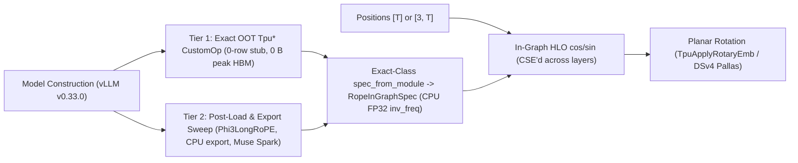

# RFC: Compute RoPE In-Graph by Default

- **Tracking Issue**: [#2747](https://github.com/vllm-project/vllm-torchtpu/issues/2747)
- **Target Upstream Version**: `vLLM v0.33.0` (pinned in `pyproject.toml`)
- **Authors**: `@maxwillzq`, `@Perseus14`
- **Status**: Proposed

> [!NOTE]
> Per `CONTRIBUTING.md`, GitHub Issue [#2747](https://github.com/vllm-project/vllm-torchtpu/issues/2747) serves as the canonical tracking thread; this document is added under `rfcs/in-graph-rope.md` to record the complete mathematical taxonomy, two-tier architecture, numerics contract, and phased rollout plan.

---

## 1. Summary & Motivation

In Transformer attention layers, Rotary Position Embedding (RoPE) is an elementary deterministic function mapping token positions (1D scalar $p$ or multimodal coordinate tuple) and a layer's rotary specification to planar rotation phases $(\cos(p\theta_i), \sin(p\theta_i))$.

Historically, LLM serving engines precompute a dense lookup table `cos_sin_cache` of shape $[L_{\text{cache}}, d_{\text{rot}}]$ at model initialization and keep it resident in accelerator High Bandwidth Memory (HBM), indexing `cos_sin_cache[positions]` on every layer. On modern long-context and multimodal models ($L_{\max} \in [128\text{K}, 1\text{M}]$), this creates four compounding problems on Cloud TPUs:

1. **Wasted Steady-State & Peak Init HBM**: Large caches consume tens of MiBs to multi-GiBs per worker even when serving short contexts—for example, `256 MiB` for DeepSeek-V4's FP32 `[1048576, 64]` cache, `384 MiB` across Gemma-4-26B's BF16 sliding (`[262144, 256]`) and global (`[262144, 512]`) caches, and up to `2 GiB` FP32 for a `1M`-context `MRotaryEmbedding` cache where `positions_factor = 4` inflates row count to $4 L_{\max}$ (`mrope.py:319,351`). This directly reduces KV-cache token capacity and inflates peak `load_model()` memory.
2. **Serving & Speculative-Decoding Complexity**: Precomputed tables require runtime workarounds across the runner—such as `TPU_ROPE_CACHE_TRUNCATE` (which requires speculative-slack bookkeeping `cdiv(max_len + spec_tokens, 8) * 8`, skips multimodal `MRotaryEmbedding` entirely, and mutates buffers post-load) and `TPU_ROPE_CACHE_ROW_MAJOR` (needed to avoid `357–513 µs` XLA `{0,1} -> {1,0}` relayout copies on the `256 MiB` table before DeepSeek-V4 Pallas kernels).
3. **Eager TPU `pow` Precision Drift at Long Contexts**: On `main`, rotary modules are instantiated under `with torch.device("tpu"):`, evaluating `inv_freq = 1.0 / (base ** (arange / d))` on TPU. At channel $j = 1$ ($\theta_1 \approx 0.75$), a single FP32 ULP ($5.96 \times 10^{-8}$) multiplied by $p = 10^6$ shifts phase by `0.06 rad`. Empirically against HuggingFace's CPU FP32 reference, `main`'s TPU-built table exhibits `1.17e-2` max abs error (`9.80%` BF16 mismatch; `13.0%` over `512K–1M`) at `base = 1e4` (`1M` positions, where errors land on higher $j$), and `1.61e-2` max abs error (**`7.72%` BF16 mismatch**) at `base = 1e6` (`262K` positions). *(Building the table on CPU and copying it to HBM would also avoid `pow` drift, but still incurs the full HBM footprint and gather/relayout overhead.)*
4. **Hardware Execution Mismatch & Exporter Constant Limits**: On TPUs, broadcast multiply + vector `cos`/`sin` in VPU registers takes `0.8–9.4 µs` ($T \in [16, 4096]$) and is common-subexpression-eliminated (CSE'd) by XLA across all layers sharing the same RoPE specification. Meanwhile, `vllm-torchtpu`'s offline exporter (`experimental/export/universal_adapter.py`) caps inline constants at `_MAX_CONSTANT_ELEMENTS = 4096`, previously requiring per-model export monkey-patches.

### Core Design Principles

1. **Exact-Class `spec_from_module` + Gated Non-vLLM Content Fallback**:
   Every upstream `vLLM` rotary class is matched by **exact class** (unwrapping registered `Tpu*` / `Vllm*` OOT wrappers one step to their exact upstream base class, never broad `isinstance`), delegating frequency calculation to CPU FP32 `_compute_inv_freq(...)` while encoding per-class cache structure (`segments`, `scaled_base`, `mscale`, `dim_modalities`, `active_rotary_dim`, `rotate_last`). Content-based phase recovery (`_recover_rope_segment_from_table`) is gated strictly to `not isinstance(module, RotaryEmbeddingBase)` for model-local buffers such as Muse Spark Open's paired `(cos, sin)` tables.
2. **Two-Tier Zero-Table Coverage (Serving + `torch.export`)**:
   - **Tier 1 (Init-Time OOT `CustomOp` Subclasses)**: Installs a 0-row `_compute_cos_sin_cache` stub during `__init__` on exact-matched `CustomOp` classes, achieving **0 B peak `load_model()` HBM** and **0 B steady-state HBM**.
   - **Tier 2 (Consolidated Post-Load & Export Sweep)**: Consolidates legacy per-variant export patches into a single post-load pass covering plain-`nn.Module` classes (`Phi3LongRoPEScaledRotaryEmbedding`), CPU-traced `torch.export` models, any custom-cache `CustomOp` subclass not yet in Tier 1, and Muse Spark paired buffers (reclaiming steady-state HBM while accepting transient init-time peak HBM on Tier-2-only modules).
3. **Explicit Parity Contract & Permanent RL Escape Hatch (`TPU_ROPE_IN_GRAPH=0`)**:
   - **`TPU_ROPE_IN_GRAPH=1` (default)**: Greedy outputs match the **CPU/HuggingFace FP32-frequency reference** (and match `main` wherever `main`'s eager TPU `pow` has negligible drift), with benchmark accuracy within `1 stderr`. *(Note: This refines [#2747](https://github.com/vllm-project/vllm-torchtpu/issues/2747)'s original "token-identical to `main`" phrasing so high-`base` models like Gemma-4 fix `main`'s TPU `pow` drift rather than reproducing it.)*
   - **`TPU_ROPE_IN_GRAPH=0` (permanent escape hatch)**: Preserves bit/token-identical parity with legacy TPU precomputed-table behavior (`main`) for RL rollout/trainer pipelines pinned to table lookup.



---

## 2. Mathematical Foundations

### 2.1 Partitioning a $d$-Dimensional Vector into a $2 \times (d/2)$ Matrix

For a single token and attention head, let $\mathbf q, \mathbf k \in \mathbb{R}^H$ ($H = d_{\text{head}}$) be query and key vectors, and let $d = d_{\text{rot}} \le H$ be the even rotary dimension:
- **Leading rotation (`rotate_last = False`, standard)**: rotates the first $d$ elements and passes the trailing $H - d$ elements through unchanged.
- **Trailing rotation (`rotate_last = True`, `DeepseekV4ScalingRotaryEmbedding`)**: passes the leading $H - d$ elements through unchanged and rotates the trailing $d$ elements.

The rotated slice $\mathbf x \in \mathbb{R}^d$ is partitioned into $\mathbf x_{\text{re}}$ and $\mathbf x_{\text{im}}$ in $\mathbb{R}^{1 \times (d/2)}$ via `is_neox_style`:

1. **GPT-NeoX Halves (`is_neox_style = True`)** — *Llama, Qwen, Gemma, Mistral, Phi*:

   ```math
   \mathbf{x}_{\text{re}} = [x_0, x_1, \dots, x_{d/2 - 1}], \qquad \mathbf{x}_{\text{im}} = [x_{d/2}, x_{d/2 + 1}, \dots, x_{d - 1}]
   ```

2. **GPT-J Even/Odd Interleaved (`is_neox_style = False`)** — *GPT-J, DeepSeek MLA `qk_rope_head_dim`, ChatGLM*:

   ```math
   \mathbf{x}_{\text{re}} = [x_0, x_2, \dots, x_{d - 2}], \qquad \mathbf{x}_{\text{im}} = [x_1, x_3, \dots, x_{d - 1}]
   ```

Under either convention, $\mathbf x$ forms a $2 \times (d/2)$ matrix $X$ isomorphic to $d/2$ complex channels $z_j = x_{\text{re}, j} + \mathrm{i}\, x_{\text{im}, j} \in \mathbb{C}$.

### 2.2 Euler's Formula, Inverse Rotation, & Relative-Distance Invariance

Rotating channel $j$ at position $m$ by $\pm m\theta_j$ (`-` when `inverse = True` in DeepSeek-V4 reverse-RoPE) multiplies $z_j$ by $e^{\pm \mathrm{i} m\theta_j} = \cos(m\theta_j) \pm \mathrm{i}\sin(m\theta_j)$. Because $\langle \mathbf u, \mathbf v \rangle = \mathrm{Re}(u \overline{v})$, attention logits depend strictly on relative offset $m - n$:

```math
\langle \tilde{\mathbf{q}}_m, \tilde{\mathbf{k}}_n \rangle
= \sum_{j=0}^{d/2 - 1} \mathrm{Re}\!\left(z_j^{(q)} e^{\mathrm{i} m\theta_j} \cdot \overline{z_j^{(k)} e^{\mathrm{i} n\theta_j}}\right)
= \sum_{j=0}^{d/2 - 1} \mathrm{Re}\!\left(z_j^{(q)} \overline{z_j^{(k)}} \, e^{\mathrm{i}(m - n)\theta_j}\right)
```

On TPU VPU, with $\mathbf c(m) = [\cos(m\theta_0), \dots, \cos(m\theta_{d/2-1})]$ and $\mathbf s(m) = [\sin(m\theta_0), \dots, \sin(m\theta_{d/2-1})]$, rotation lowers purely to element-wise fused multiply-add ($\odot$):

```math
\tilde{X} = \begin{bmatrix} \mathbf{x}_{\text{re}} \\ \mathbf{x}_{\text{im}} \end{bmatrix} \odot \begin{bmatrix} \mathbf{c}(m) \\ \mathbf{c}(m) \end{bmatrix}
+ \begin{bmatrix} -\mathbf{x}_{\text{im}} \\ \mathbf{x}_{\text{re}} \end{bmatrix} \odot \begin{bmatrix} \mathbf{s}(m) \\ \mathbf{s}(m) \end{bmatrix}
```

---

## 3. Taxonomy of `vLLM v0.33.0` Rotary Classes (All 19 Classes)

Unscaled RoPE defines inverse frequencies $\theta_i = b^{-2i / d_{\text{rot}}}$ for $i \in \{0, \dots, d_{\text{rot}}/2 - 1\}$ with base $b$ (`rope_theta`), from fast syntactic channel $i = 0$ ($\theta_0 = 1$) to slow long-range channel $i \to d_{\text{rot}}/2 - 1$.

In `vLLM v0.33.0` (`vllm/model_executor/layers/rotary_embedding/`), there are **19 rotary classes** (`RotaryEmbeddingBase` + 18 concrete classes, alongside helper ops `ApplyRotaryEmb` and `VitMropeSetup`): **14 Tier 1**, **1 Tier 2**, and **3 Out-of-Scope**.

### 3.1 Category 1: Static Frequency Vector ($\boldsymbol{\theta}^* \in \mathbb{R}^{d_{\text{rot}}/2},\; s = 1$)

1. **Default (`RotaryEmbedding`, `rope_type = "default"`)**: $\theta_i^* = b^{-2i / d_{\text{rot}}}$.
2. **Linear Position Interpolation (`LinearScalingRotaryEmbedding`, `rope_type = "linear"`)**:
   $\theta_i^*(c_k) = \theta_i / c_k$ for each factor $c_k$ in `scaling_factors`, represented as $K$ contiguous `CosSinSegment`s indexed via additive `offsets` from `scaling_factor_to_offset`.
3. **NTK-Aware Scaling (`NTKScalingRotaryEmbedding`, `rope_type = "ntk"`)**:
   - *Fixed (`mixed_b = None`)*: $\theta_i^* = (b \cdot c)^{-2i / d_{\text{rot}}} \cdot c^{-2 / d_{\text{rot}}} = \theta_i \cdot c^{-2(i + 1)/d_{\text{rot}}}$.
   - *Mixed (`mixed_b` = $\beta$)*:

     ```math
     \theta_i^* = \frac{\theta_i}{\exp\!\left(\frac{\ln c}{(d_{\text{rot}}/2)^\beta} (i + 1)^\beta\right)}
     ```

4. **Dynamic NTK (`DynamicNTKScalingRotaryEmbedding`, `DynamicNTKAlphaRotaryEmbedding`, `rope_type = "dynamic"`)**:

   ```math
   b'_{\text{factor}} = b \cdot \left(\frac{c \cdot L_{\max}}{L_{\text{orig}}} - (c - 1)\right)^{\frac{d_{\text{rot}}}{d_{\text{rot}} - 2}}, \qquad b'_{\text{alpha}} = b \cdot \alpha^{\frac{d_{\text{rot}}}{d_{\text{rot}} - 2}}, \qquad \theta_i^* = (b')^{-\frac{2i}{d_{\text{rot}}}}
   ```

5. **Llama-3 Piecewise Wavelength Smoothing (`Llama3RotaryEmbedding`, `rope_type = "llama3"`)**:
   With wavelength $\lambda_i = 2\pi / \theta_i$:

   ```math
   \theta_i^* = \begin{cases}
   \theta_i, & \lambda_i < \dfrac{L_{\text{orig}}}{f_{\text{high}}} \\[6pt]
   \dfrac{\theta_i}{c}, & \lambda_i > \dfrac{L_{\text{orig}}}{f_{\text{low}}} \\[8pt]
   (1 - \gamma_i)\dfrac{\theta_i}{c} + \gamma_i \theta_i, & \text{otherwise, where } \gamma_i = \dfrac{L_{\text{orig}}/\lambda_i - f_{\text{low}}}{f_{\text{high}} - f_{\text{low}}}
   \end{cases}
   ```

6. **Gemma-4 Proportional RoPE (`Gemma4RotaryEmbedding`, `rope_type = "proportional"`)**:
   Upstream `__init__` sets $K_{\text{rot}}$ (`rope_angles = rotary_dim_in // 2`), `nope_angles = head_size // 2 - rope_angles`, and overwrites `self.rotary_dim = head_size` (e.g. on Gemma-4-26B global attention, `head_size = 512, rope_angles = 64, nope_angles = 192`):

   ```math
   \theta_i^* = \begin{cases}
   b^{-\frac{2i}{d_{\text{head}}}}, & 0 \le i < K_{\text{rot}} \\[6pt]
   0, & K_{\text{rot}} \le i < \dfrac{d_{\text{head}}}{2}
   \end{cases}
   ```

> [!TIP]
> **Compact Proportional Execution (Phase 4)**: `RopeInGraphSpec` records `rotary_dim = module.head_size` and `active_rotary_dim = 2 * module.rope_angles`, slicing and rotating only the non-zero `rope_angles` pairs from each NeoX half and skipping `cos`/`sin` + FMA on the 75% zero-padded `nope_angles` channels (`torch.equal` bit-exact).

---

### 3.2 Category 2: Frequency Ramp + Magnitude Scaling ($s \ne 1$, YaRN Family)

YaRN classes blend frequencies via `yarn_find_correction_range` + linear ramp mask $\gamma_i \in [0, 1]$ ($\theta_i^* = (1 - \gamma_i)\frac{\theta_i}{c} + \gamma_i \theta_i$) and multiply $(\cos, \sin)$ by scalar `mscale` ($s$), where $\mathrm{mscale}(c, m) = 1$ if $c \le 1$ else $0.1\, m \ln c + 1$:

1. **YaRN (`YaRNScalingRotaryEmbedding`, `rope_type = "yarn"`, `v0.33.0` `yarn_scaling_rope.py:38-46`)**:
   - $s = \alpha_{\text{attn}}$ if `attention_factor` is provided;
   - else $s = \mathrm{mscale}(c, m_1) / \mathrm{mscale}(c, m_2)$ when both `mscale` ($m_1$) and `mscale_all_dim` ($m_2$) are truthy;
   - else $s = \mathrm{mscale}(c, 1)$.
2. **DeepSeek MLA YaRN (`DeepseekScalingRotaryEmbedding`, `DeepseekV4ScalingRotaryEmbedding`, `rope_type = "deepseek_yarn"`)**:

   ```math
   s = \frac{\mathrm{mscale}(c, m_1)}{\mathrm{mscale}(c, m_2)}
   ```

---

### 3.3 Category 3: Calibrated Two-Regime Variants (`Phi3LongRoPE`, Tier 2)

**Phi-3 / Phi-4 LongRoPE (`Phi3LongRoPEScaledRotaryEmbedding`, `rope_type = "longrope"`)**:
Applies calibrated per-channel divisors (`short_factor` and `long_factor`), with per-regime magnitude scales `short_mscale` and `long_mscale` each defaulting to $\sqrt{1 + \ln(L_{\max}/L_{\text{orig}})/\ln L_{\text{orig}}}$ when $L_{\max} > L_{\text{orig}}$ (else $1.0$). Upstream selects `self.use_long_rope = max_model_len > original_max_position_embeddings` **statically at `__init__`**, builds a `[L_orig + L_max, d_rot]` buffer `long_short_cos_sin_cache`, and shifts `idx = positions + L_orig` when `use_long_rope` is `True` (plus optional additive `offsets`). Because `Phi3LongRoPEScaledRotaryEmbedding` subclasses `nn.Module` directly (not `CustomOp`), it is handled deterministically in **Tier 2** via a two-segment `InGraphCosSinCache`.

---

### 3.4 Category 4: Multi-Dimensional Coordinate RoPE (`[3, T]` M-RoPE Family)

All four `v0.33.0` 3D multimodal classes accept 1D `[T]` (text-only) or 2D `[3, T]` (`[temporal, height, width]`) `positions` and unify into a static per-pair modality tuple `dim_modalities` $\mathbf m \in \{0, 1, 2\}^{d_{\text{rot}}/2}$:

1. **Contiguous `MRotaryEmbedding` (`mrope_interleaved = False`, e.g. Qwen2-VL / Qwen2.5-VL)**:
   $\mathbf m = [0^{D_t}, 1^{D_h}, 2^{D_w}]$ for `mrope_section = [D_t, D_h, D_w]` (with optional YaRN `scaling_factor` & `mscale`).
2. **Interleaved `MRotaryEmbedding` (`mrope_interleaved = True`, e.g. Qwen3-VL / Qwen3.5)**:
   Matches `apply_interleaved_rope` (`mrope.py:225-234`): channel `ch` maps to $H$ (`1`) if `ch % 3 == 1 and ch < 3 * D_h`, to $W$ (`2`) if `ch % 3 == 2 and ch < 3 * D_w`, and to $T$ (`0`) otherwise.
3. **OpenPangu `MRotaryEmbeddingInterleaved` (`rope_type = "openpangu"`)**:
   Uses rarest-first `get_mrope_interleaved_id_list` stored directly on `module.mrope_dim[:d_rot // 2]`.
4. **Spatial-Pair + Temporal-Tail Variants (`Ernie4_5_VLRotaryEmbedding`, `BailingMRotaryEmbedding`)**:
   - `Ernie4_5_VLRotaryEmbedding`: even/odd `[H, W, H, W, ...]` across the first $D_h + D_w$ pairs ($D_h = D_w$), followed by $D_t$ temporal pairs.
   - `BailingMRotaryEmbedding` (`rope_type = "bailing_mrope"`): even/odd `[H, W, H, W, ...]` across `module.spatial_size` pairs, followed by `rotary_dim // 2 - spatial_size` temporal pairs.

When `positions.ndim == 1`, `positions` broadcasts across all channels directly; when `positions.ndim == 2`, pure-HLO selection maps `pos_for_freq[t, i] = positions[m_i, t]` without recompiling between text and multimodal batches of the same shape.

---

### 3.5 Explicitly Out-of-Scope Classes (3 of 19 in `v0.33.0`)

1. **`FourierRotaryEmbedding` (`fope.py`)**: Uses checkpoint-loaded learned `nn.Parameter` basis-mixing weights (`cos_coef`, `sin_coef`) rather than a closed-form function of configuration.
2. **`DualChunkRotaryEmbedding` (`dual_chunk_rope.py`)**: Hardcodes `torch.device(f"cuda:{device_idx}")` in `__init__` and maintains 5 dual-chunk caches; CUDA-only upstream.
3. **`Llama4VisionRotaryEmbedding` (`llama4_vision_rope.py`)**: Builds bounded 2D image-patch `complex64` tile frequencies (`<= 4096` patches, `< 1 MiB`) independent of LLM context length $L_{\max}$. *(Note: Standard ViT rotary embeddings created via `get_rope()`, such as Qwen2/2.5/3-VL vision towers calling `get_cos_sin(seqlen)`, **are** in scope and converted by Tier 1.)*

---

## 4. `vllm-torchtpu` Two-Tier Architecture

### 4.1 Exact-Class `spec_from_module` Extractor

Both Tier 1 and Tier 2 call a single `spec_from_module(module) -> RopeInGraphSpec` function:
1. **Unwrap OOT Wrapper -> Match Exact Upstream Class**: Unwraps one registered `Tpu*` / `Vllm*` OOT subclass layer to resolve the exact upstream class `cls`, then dispatches on `cls` directly (never `isinstance`, preventing subclasses like `BailingMRotaryEmbedding` from matching `MRotaryEmbedding`'s layout).
2. **Delegate Frequency Math to CPU FP32 `_compute_inv_freq`, Encode Structure Explicitly**:
   - Evaluates `module._compute_inv_freq(...)` under `with torch.device("cpu"):` in FP32 (matching HuggingFace's CPU reference), handling `MRotaryEmbedding`'s parameter-name quirk where `_compute_inv_freq(self, base)` expects `self.scaling_factor` when YaRN scaling is active (`mrope.py:366-370, 77`).
   - Encodes per-class cache structure explicitly for `LinearScalingRotaryEmbedding` (multi-factor segments), `DynamicNTK*` (`scaled_base`), `Phi3LongRoPEScaledRotaryEmbedding` (short + long segments), `Gemma4RotaryEmbedding` (`active_rotary_dim = 2 * rope_angles`), `DeepseekV4ScalingRotaryEmbedding` (`rotate_last = True`, `cache_dtype = torch.float32`), and the four M-RoPE classes (`dim_modalities`).

```python
@dataclass(frozen=True)
class RopeInGraphSpec:
    segments: tuple[CosSinSegment, ...]  # (start, length, inv_freq_f32, mscale)
    rotary_dim: int  # module.rotary_dim (head_size on Gemma4)
    active_rotary_dim: int  # Non-identity rotary_dim (2 * rope_angles on Gemma4)
    cache_dtype: torch.dtype  # Rounding dtype before rotation
    match_query_dtype: bool = True  # True if upstream calls _match_cos_sin_cache_dtype
    is_neox_style: bool = True
    rotate_last: bool = False  # True for DeepseekV4ScalingRotaryEmbedding
    dim_modalities: tuple[int, ...] | None = None
```

---

### 4.2 Tier 1 (Init-Time OOT) & Tier 2 (Post-Load / Export Sweep)

#### Upstream `init_cache` & Dispatch Constraints (`v0.33.0`)

Across the 19 rotary classes in `v0.33.0`, only **4** accept `init_cache: bool` (`RotaryEmbeddingBase`, `RotaryEmbedding`, `DeepseekScalingRotaryEmbedding`, `FourierRotaryEmbedding`), while `DeepseekV4ScalingRotaryEmbedding.__init__` pops `init_cache` and unconditionally builds an FP32 `cos_sin_cache`. Additionally, `MRotaryEmbeddingInterleaved` overrides `forward` directly (bypassing `CustomOp.dispatch_forward`), and `Phi3LongRoPEScaledRotaryEmbedding` subclasses `nn.Module` directly.

#### Tier 1: Exact OOT `Tpu*` Subclasses (`0 B` Peak & Steady-State HBM)

- **0-Row `_compute_cos_sin_cache` Stub on Verified Classes Only**: On the exact-matched Tier 1 `CustomOp` classes (`RotaryEmbedding`, `Llama3`, `Gemma4`, `NTK`, `LinearScaling`, `DynamicNTKScaling`, `DynamicNTKAlpha`, `YaRNScaling`, repo-owned `VllmDeepseekScalingRotaryEmbedding`, `MRotaryEmbedding`, `MRotaryEmbeddingInterleaved`, `Ernie4_5_VL`, `BailingMRotaryEmbedding`, plus `DeepseekV4Scaling` starting in **Phase 3**), `_TpuInGraphRotaryMixin` overrides `_compute_cos_sin_cache` to return `torch.empty((0, self.rotary_dim), dtype=torch.float32, device="cpu")`, replicates `LinearScalingRotaryEmbedding._scaling_factor_to_offset` from `spec.segments`, drops the 0-row buffer after `super().__init__`, and attaches `self._in_graph_spec` + zero-HBM `InGraphCosSinCache` (including `get_cos_sin` and `select_cos_sin` support, and overriding `forward` on `MRotaryEmbeddingInterleaved`).
- **Preserving `main`'s MRO Auto-Discovery Safely**: `_discover_static_rope_classes` keeps `main`'s `forward_native`-only MRO check for FP32 rotation, but installs the 0-row cache stub **only** when `cls._compute_cos_sin_cache is RotaryEmbeddingBase._compute_cos_sin_cache`. Any future subclass overriding `_compute_cos_sin_cache` keeps its FP32-rotation OOT wrapper, builds its buffer normally, and falls through to Tier 2—guaranteeing Tier 1 **never** hits a cacheless `None` state and **never** allocates multi-GiB verification tables on CPU at startup.

#### Tier 2: Consolidated Post-Load & Export Sweep (`rope_patch.py`)

`patch_in_graph_rotary_embedding(model)` runs on CPU after model/drafter load in `TPUModelRunner` and in `experimental/export/universal_adapter.py`:
- Skips modules already converted by Tier 1.
- Converts `Phi3LongRoPEScaledRotaryEmbedding` (`long_short_cos_sin_cache`), CPU-loaded `torch.export` models, and any custom-cache `RotaryEmbeddingBase` subclass missed by Tier 1 via exact-class `spec_from_module` + sampled CPU row verification.
- Applies content-based `_recover_rope_segment_from_table` **only** when `not isinstance(module, RotaryEmbeddingBase)` (e.g., Muse Spark Open's paired `cos`/`sin` buffers via `patch_cos_sin_table_pairs`).
- Logs `warning_once` if an unexpected rotary buffer outside §3.5 cannot be converted.

---

### 4.3 Audit of Direct `.cos_sin_cache` Consumers (`vLLM v0.33.0`, `main`)

| Consumer | Access Pattern | In-Graph Resolution |
| :--- | :--- | :--- |
| **`RotaryEmbeddingBase.forward_native` / `_match_cos_sin_cache_dtype`** | Reads `.device`/`.dtype`, `.to(query.device, dtype=query.dtype)`, `index_select(0, pos)` | Tier 1/2 `forward` evaluates `(cos, sin)` directly; `InGraphCosSinCache` implements `.device`, `.dtype`, `.shape`, `.size()`, `.to(...)`, `index_select`, `__getitem__`, and `__torch_function__(torch.index_select)`. |
| **`RotaryEmbeddingBase.get_cos_sin(seqlen)`** (Vision towers: `Qwen2/2.5/3-VL`, `Qwen3-Omni`, `GLM-4.1V`, `MiMo-V2-Omni`) | Calls `rotary_pos_emb.get_cos_sin(seqlen)` -> `self.cos_sin_cache[:seqlen]` on a standard `RotaryEmbedding` | Tier 1/2 overrides `get_cos_sin(seqlen)` (and `InGraphCosSinCache.__getitem__(slice)`) to compute `[0, seqlen)` rows in-graph. |
| **`BailingMRotaryEmbedding.select_cos_sin`** (`bailing_mrope.py:259`) | Slices `cos_sin_cache[positions.long()]` after `_match_cos_sin_cache_dtype(query)` | Tier 1 `TpuBailingMRotaryEmbedding` evaluates `[H, W, ... | T]` `dim_modalities` in-graph; `InGraphCosSinCache.__getitem__` also supports 2D `positions` tensors. |
| **`mla_attention_op.py`** (`VllmTPUMultiHeadLatentAttentionWrapper`, `VllmDeepseekScalingRotaryEmbedding`) | `process_weights_after_loading` calls `cos_sin_cache.to(device)`; `forward_native` calls `index_select(0, pos)` | Repo-owned `VllmDeepseekScalingRotaryEmbedding` is a Tier 1 class; `InGraphCosSinCache.to(device)` and `index_select` evaluate in-graph. |
| **Speculative Drafters (`Qwen3DFlashModel`, `Gemma4DSparkModel`)** | `__init__` stashes dead CUDA alias `self._rope_cos_sin_cache = attn0.rotary_emb.cos_sin_cache` | `InGraphCosSinCache` satisfies init attribute read; `drop_unused_rope_cache_aliases` removes `_rope_cos_sin_cache` so draft aliases cannot pin replaced/truncated buffers. |
| **DeepSeek-V4 & V4.1 Pallas Ops** (`models/vllm/deepseek_v4/*`, `custom_ops/deepseek_v4/*`, `kernels/deepseek_v4/*`, plus [#2840](https://github.com/vllm-project/vllm-torchtpu/pull/2840)'s `rope_gather.py` & `deepseek_v41/v2/csa2_adapter.py`) | Pass full `[1M, 64]` FP32 `cos_sin_cache` + `positions` into Pallas/JAX ops | Skipped in Phase 2a/2b; migrated in **Phase 3** to accept contiguous FP32 per-token `cos_sin [T, rotary_dim]` (and quantized `(positions // r) * r` for `compress_and_store`). |
| **Upstream CUDA-Only Fused Ops** (`deepseek_v2.py` `fused_indexer_q_rope_quant`, `qwen3_next.py` `fused_qk_rmsnorm_rope_gate`, `hy_v3.py` `HpcRopeNorm`) | Pass `rotary_emb.cos_sin_cache` to CUDA kernels | Gated behind `current_platform.is_cuda()` / custom-op checks; never executed on TPU. |

---

### 4.4 TPU Numerics, Constant Folding, & Per-Class Dtype Contract

1. **Scalar Constant Lowering (`_build_device_vector_f32`)**: `inv_freq_f32` floats are lowered as scalar `torch.full((), float(v), dtype=torch.float32, device=positions.device)` + `torch.stack` ops—capturing **zero** host tensor buffers in `torch.export` (`0 B` PJRT cache metadata pickles) while XLA constant-folds them into a single `[1, d_active/2]` literal (`power: 0, gather: 0, cosine: 1, sine: 1`) CSE'd across layers.
2. **Per-Class `(cos, sin)` Rounding Dtype**: Angles and `cos`/`sin` $\cdot$ `mscale` are always evaluated in **FP32**, then cast to match each upstream class's exact cache-rounding behavior before planar rotation:

| `v0.33.0` Class Group | Upstream Cache Rounding Before Rotation | In-Graph `(cos, sin)` Cast | Planar Rotation Compute |
| :--- | :--- | :--- | :--- |
| `RotaryEmbedding`, `Llama3`, `Gemma4`, `NTK`, `Linear`, `DynamicNTK*`, `YaRN`, **`MRotaryEmbedding`**, **`BailingMRotaryEmbedding`** | `_match_cos_sin_cache_dtype(query)` (`module.dtype` then `query.dtype`) | Cast to `module.dtype` then `query.dtype` (BF16) | **FP32** (`TpuApplyRotaryEmb`), cast output to `query.dtype` |
| **`MRotaryEmbeddingInterleaved`** (`openpangu`), **`Ernie4_5_VLRotaryEmbedding`** | Raw `self.cos_sin_cache` (`module.dtype`) | Cast to `module.dtype` | **FP32** (`TpuApplyRotaryEmb`), cast output to `query.dtype` |
| `DeepseekScalingRotaryEmbedding` / `VllmDeepseekScalingRotaryEmbedding`, `Phi3LongRoPE` | Raw cache (`module.dtype`) | Cast to `module.dtype` | `module.dtype` (with explicit `.to(q_pe_dtype)` in `mla_attention_op`) |
| **`DeepseekV4ScalingRotaryEmbedding` & DSv4/V4.1 Pallas Kernels** | **FP32 by design** (`deepseek_scaling_rope.py:240`) | **Kept in FP32 (`torch.float32`)** | **FP32** inside `forward_native` and Pallas kernels |

---

### 4.5 Limitations, Risks, & Rejected Alternatives

- **Tier-2 Peak Init HBM**: Plain-`nn.Module` (`Phi3LongRoPE`) and custom-buffer (`Muse Spark`) models still allocate their cache during `load_model()` before Tier 2 frees it; only steady-state HBM is reclaimed for those models.
- **`TPU_ROPE_IN_GRAPH=0` Trade-offs**:
  - `=0` guarantees bit-exact parity with legacy TPU behavior (`main`), *not* CUDA/CPU tables on high-`base` models where `main`'s TPU `pow` drifts.
  - Once `TPU_ROPE_CACHE_TRUNCATE` is removed in Phase 5, `=0` retains full untruncated `[L_cache, d_rot]` tables in HBM (e.g. `256 MiB` on DSv4).
  - Under `=0` after Phase 3, DSv4 gathers `cos_sin_cache[positions]` -> `[T, 64]` in XLA before Pallas; XLA gather is expected not to trigger the `256 MiB` Pallas layout copy, which will be verified with an `xprof` trace before deleting `TPU_ROPE_CACHE_ROW_MAJOR` in Phase 5.
- **Dynamo Contract for `InGraphCosSinCache`**: `InGraphCosSinCache` is a non-`Tensor` Python proxy implementing `__torch_function__` for `index_select`. Under `torch.compile`, Dynamo traces through its Python methods into pure tensor ops (`0` recompilations verified across serving shapes); any unsupported tensor op raises `NotImplementedError` at trace time rather than silently miscompiling.
- **Rejected Alternative — Computing `cos`/`sin` Inside Pallas Kernels**: Computing `cos`/`sin` inside each DSv4 Pallas kernel (`rope`, `qnorm_rope`, `fused_reverse_rope_wo_a`) was rejected because it would duplicate transcendental evaluation `3 × num_layers` times per step in VPU kernel code instead of letting XLA CSE a single `[T, 64]` evaluation across all layers.

---

## 5. Empirical Validation (`vLLM v0.33.0`, Cloud TPU `v7x-8`)

### 5.1 Numerics & Isolated Microbenchmarks (`v7x`)

| Study | Configuration | Max Abs Error vs CPU FP32 Ref | BF16 Mismatch vs CPU/HF Table | HLO (`pow / gather / cos / sin`) |
| :--- | :--- | ---: | ---: | :--- |
| **`1M` Positions** (`d_rot=64, base=1e4`) | `main` eager TPU table (`torch.device("tpu")`) | `1.17e-2` | `9.80%` (`13.0%` at `512K–1M`) | `0 / 1 / 0 / 0` (+ `256 MiB` param) |
| | **In-Graph HLO (FP32)** | **`9.1e-8`** | **`0.00%`** | **`0 / 0 / 1 / 1`** (`0 B` param) |
| **Served `262K` Positions** (`d_rot=128`, BF16) | `main` eager TPU table (`torch.device("tpu")`) | `1.61e-2` | `7.72%` | `0 / 1 / 0 / 0` |
| | **In-Graph HLO (BF16-rounded)** | **`1.95e-3`** ($\frac{1}{2}$ BF16 ULP) | **`0.00045%`** (`75 / 16.7M`) | **`0 / 0 / 1 / 1`** (CSE'd) |

- **Synthetic 4-Layer Proportional Microbenchmark (`Gemma4RotaryEmbedding`, synthetic `head_size=256, rope_angles=32`, 75% `nope_angles`)**: Compact proportional slicing (`f32[T, 128] -> f32[T, 32]`) cuts HLO fusions **`17 -> 7`** and `T=4096` median latency **`1,085.3 µs -> 582.8 µs` (`1.86x`)** with `torch.equal == True` vs full-width rotation. *(Phase 4 PR will additionally report `head_size=512, rope_angles=64` matching Gemma-4-26B global layers.)*
- **DeepSeek-V4 Pallas Kernels (local Phase-3 prototype, `jax.profiler` on `v7x`, `T=4096`, FP32 `cos_sin`)**: Per-token `cos_sin [T, 64]` runs `rope` in `62.1 µs` (vs `63.7 µs`), `qnorm_rope` in `123.0 µs` (vs `124.8 µs`), and `fused_reverse_rope_wo_a` in `252.0 µs` (vs `276.2 µs`), adds `0.8–9.4 µs` for the CSE'd `cos`/`sin` fusion, and eliminates the `256 MiB` table operand and its `357–513 µs` unpinned relayout copy.

### 5.2 End-to-End Serving, HBM, & Accuracy (`vLLM v0.33.0`, `v7x-8`)

*(Throughput deltas of `±0.2%–0.7%` are within run-to-run measurement noise, confirming zero throughput regression.)*

| Model & Topology | Upstream Cache Shapes Removed | HBM Delta & KV Cache Gain | Output `tok/s` (`IN_GRAPH=1` vs `main`) | Accuracy (`± stderr`) | Parity & Recompilation Notes |
| :--- | :--- | :--- | :--- | :--- | :--- |
| **`Gemma-4-26B-A4B-FP8`** (`TP=2, DP=4, EP`) | Sliding `[262144, 256]` (`128 MiB`) + Global `[262144, 512]` (`256 MiB`) BF16 = `384 MiB` | **`-380 MiB/chip`**, **`+12,488` KV tokens (`DP=4` total)** | `13,100.7` vs `13,008.4` | `gsm8k` (`n=300`): `0.9467 ± 0.0130` vs `0.9433 ± 0.0134` | **`8/8` exact** vs CPU/HF ref (`main` was `2/8`); `=0`: `8/8` vs `main` |
| **`Qwen3.5-9B`** (`TP=1`, text-only) | `MRotaryEmbedding` (`positions_factor=1`) `[262144, 64]` BF16 = `32 MiB` | **`-30 MiB/chip`**, **`+410` KV tokens** | `4,715.7` vs `4,691.0` | `gsm8k` (`n=300`): `0.9333 ± 0.0144` vs `0.9367 ± 0.0141` | `0` recompiles; `=0`: `8/8` vs `main` |
| **`DeepSeek-V2-Lite`** (`TP=1`, FP8 KV) | `DeepseekScaling` (`is_neox=False`, `mscale=mscale_all_dim=0.707` -> eff. `s=1.0`) `[163840, 64]` BF16 = `20 MiB` | **`+1,024` KV tokens** | `4,459.0` vs `4,440.4` | `mmlu_pro` (`n=1400`): `0.3121 ± 0.0122` vs `0.3179 ± 0.0123` | `0` recompiles; `=0`: `8/8` vs `main` |
| **`DeepSeek-V4-Flash`** *(Phase-3 local prototype, `TP=1, DP=8, EP`)* | `DeepseekV4Scaling` `[1048576, 64]` FP32 = `256 MiB` | **`+75,240` KV tokens (`DP=8` total)** | `6,026.9` vs `6,038.9` | `mmlu_pro` (`n=1400`): `0.8186 ± 0.0102` vs `0.8157 ± 0.0102` | `=0`: `8/8` vs `main`; trace artifacts to attach on Phase 3 PR |
| **`Qwen3-4B + DFlash`** (`K=15`) | Shared target/draft `RotaryEmbedding` + dead `_rope_cos_sin_cache` alias | Alias dropped; `0` recompiles | Parity with `main` | `60.9%` pos-0 acceptance (`= main`) | Verified under `IN_GRAPH=1` and `=0` |

---

## 6. Phased Implementation Plan & Acceptance Gates

### 6.1 PR Rollout Plan

| Phase | Scope | Status |
| :--- | :--- | :--- |
| **Phase 0** | **Shared Module Scaffolding**: Move `rope_patch.py` out of `experimental/export` into `src/vllm_torchtpu/rope_patch.py`. | **Merged** ([#2827](https://github.com/vllm-project/vllm-torchtpu/pull/2827)) |
| **Phase 1** | **Design Alignment (This RFC)**: Land `rfcs/in-graph-rope.md`, post architectural summary on [#2747](https://github.com/vllm-project/vllm-torchtpu/issues/2747), and confirm the CPU/HF greedy-parity contract with maintainers. | **This Document** |
| **Phase 2a** | **Default-On In-Graph RoPE (Tier 2 Post-Load + Export)**: Enable `TPU_ROPE_IN_GRAPH=1` by default, CPU FP32 scalar `inv_freq` lowering, analytical extraction + fallback, DFlash/DSpark alias cleanup, and export consolidation (DSv4 Pallas ops skipped). *(Defensively cleans up `_tpu_compact_*` attrs if [#2819](https://github.com/vllm-project/vllm-torchtpu/pull/2819) is present.)* | **Open** ([#2866](https://github.com/vllm-project/vllm-torchtpu/pull/2866), CI Green: 29 passed, 3 conditional steps cancelled) |
| **Phase 2b** | **Tier 1 Init-Time OOT Zero-Allocation**: Unify exact-class `spec_from_module`, add 0-row `_compute_cos_sin_cache` stub + `Linear` `_scaling_factor_to_offset` across `layers/adapter/rotary_embedding.py` and `VllmDeepseekScalingRotaryEmbedding` (`mla_attention_op.py`), add `BailingMRotaryEmbedding` support, and gate `_recover_rope_segment_from_table` strictly to `not isinstance(module, RotaryEmbeddingBase)`. | Planned PR (stacked on `#2866`) |
| **Phase 3** | **DeepSeek-V4 & V4.1 Pallas Kernel Migration**: Switch `kernels/deepseek_v4/*`, `custom_ops/deepseek_v4/*`, `models/vllm/deepseek_v4/*`, and [#2840](https://github.com/vllm-project/vllm-torchtpu/pull/2840)'s `rope_gather.py` / `deepseek_v41/v2/csa2_adapter.py` to FP32 per-token `cos_sin [T, rotary_dim]`, and promote `DeepseekV4ScalingRotaryEmbedding` into Tier 1. | Planned PR |
| **Phase 4** | **Compact Proportional RoPE**: Enable `active_rotary_dim = 2 * rope_angles` slicing by default for `Gemma4RotaryEmbedding` without an extra `TPU_COMPACT_ROPE` env var (coordinating closure/superseding with `@prishajain1` on [#2819](https://github.com/vllm-project/vllm-torchtpu/pull/2819)). | Planned PR |
| **Phase 5** | **Legacy Knob Retirement**: Remove `TPU_ROPE_CACHE_TRUNCATE`, `TPU_ROPE_CACHE_ROW_MAJOR`, `_truncate_rope_caches`, and `relayout_rope_caches` (**preserving** `_install_entry_layout_pin` and `_to_row_major` for `relayout_hash_tables` / `TPU_MOE_HASH_TABLE_ROW_MAJOR`), while retaining Tier 2 (`Phi3LongRoPE`, export, Muse Spark) and `TPU_ROPE_IN_GRAPH=0`. | Planned PR |

### 6.2 Per-Phase Acceptance Gates

1. **Phase 2b (Tier 1 + Exhaustiveness + Distinct-Path Coverage)**:
   - **Subclass-Exhaustiveness CI Guard**: Walks all subclasses of `RotaryEmbeddingBase` (plus `DualChunkRotaryEmbedding` and `Phi3LongRoPEScaledRotaryEmbedding`) in `vllm.model_executor.layers.rotary_embedding` and fails CI if any class is absent from `TIER1_CLASSES | TIER2_CLASSES | OUT_OF_SCOPE_CLASSES`—catching new classes on future vLLM version bumps automatically.
   - **Per-Class CPU Bit-Exact Spec Test**: Parametrized over all 15 in-scope `v0.33.0` classes (including multi-factor `LinearScaling`, `YaRN` with `mscale != 1.0`, `Phi3LongRoPE`, and all 4 M-RoPE classes with distinct `T != H != W` coordinates), asserting FP32 `(cos, sin)` / rotated `(q, k)` match upstream `_compute_cos_sin_cache()` and `forward_native` (and asserting `not isinstance(mod, RotaryEmbeddingBase)` never triggers content recovery on upstream classes).
   - **Pre-Sweep Init-Peak Test**: Asserts *immediately after Tier-1 construction (before Tier 2 runs)* that no Tier-1 module holds any `*cos_sin*` buffer with `numel() > 0`.
   - **Targeted E2E Additions**: One `Phi-4-mini` (`Phi3LongRoPE`, Tier 2) run, one true `mscale != 1.0` YaRN/DeepSeek run, and one multimodal image/video VL prompt (`T != H != W`).
2. **Phase 3 (DSv4 / V4.1 Pallas)**: Attach `xprof` / `jax.profiler` traces on the PR demonstrating `0` table relayout copies under both `TPU_ROPE_IN_GRAPH=1` and `=0`, plus `256 MiB/worker` HBM reduction and `IN_GRAPH=0` greedy parity.
3. **Phase 4 (Compact Proportional)**: Attach HLO fusion dump and latency microbenchmark at both `256/32` and Gemma-4-26B's `512/64` global head geometry (`torch.equal` vs full-width).
4. **Phase 5 (Cleanup)**: Confirm via Phase-3 `xprof` that `TPU_ROPE_IN_GRAPH=0` requires no `ROW_MAJOR` pin, verify `TPU_MOE_HASH_TABLE_ROW_MAJOR` unit tests pass, and document `TPU_ROPE_IN_GRAPH=0`'s untruncated HBM behavior in `docs/reference/env_vars.md`.
